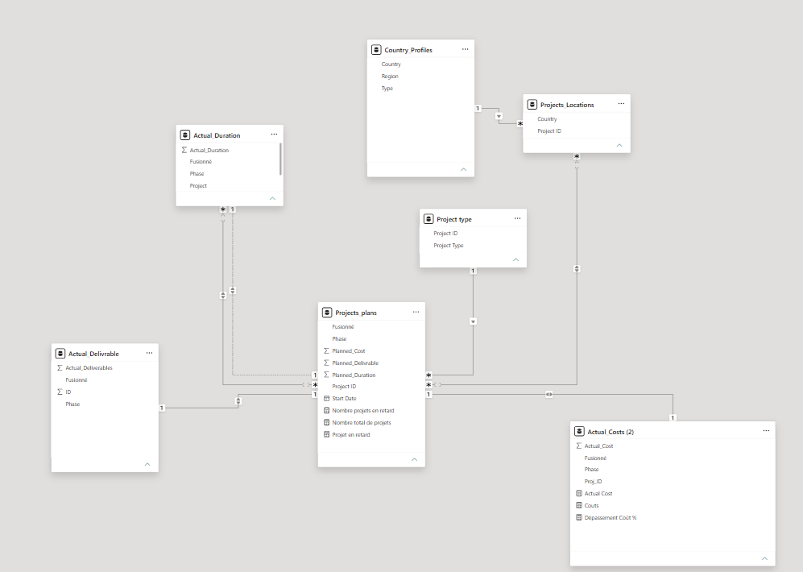
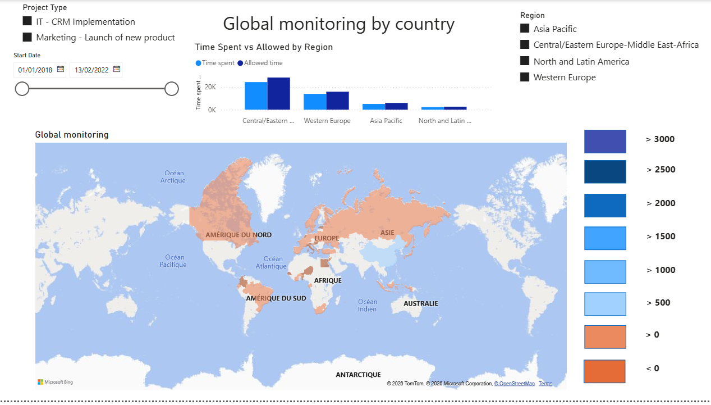
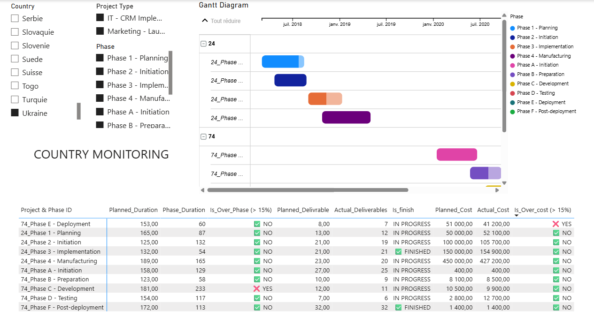

# Suivi-de-l-avancement-de-projets

Power BI · DAX · Power Query · Formation

Conception d'un tableau de bord interactif à trois niveaux (groupe, région, pays) pour suivre l'avancement de 104 projets IT et Marketing dans 52 pays, et repérer ceux qui dérivent en coût, en délai ou en livrables.

## Contexte

Ce projet a été réalisé dans le cadre de ma formation de Data Analyst chez OpenClassrooms. La mission : concevoir pour Sanitoral un tableau de bord de pilotage de son portefeuille de projets IT (implémentation CRM) et Marketing (lancement de produit).

Le dashboard répond aux besoins de trois profils, formalisés dans un « strategic canvas » :

- **Le CEO** : vue globale, comparaison des régions, nombre de projets en alerte
- **Le directeur régional** : focus sur sa région, comparaison des pays, filtre par type de projet
- **Le directeur pays** : détail des coûts, délais et livrables de chaque projet, phase par phase

Une alerte est déclenchée lorsqu'un projet dépasse de plus de 15 % son budget ou son délai prévu.

## Démarche

1. **Préparation des données (Power Query)**
   - Import de 7 feuilles Excel (plans, coûts réels, durées réelles, livrables réels, localisation, types de projet, profils pays)
   - Suppression des lignes d'en-tête, promotion des en-têtes, typage des colonnes, suppression des lignes vides
   - Création d'une clé composite « Projet_Phase » pour relier plans prévisionnels et réalisations, phase par phase

2. **Modélisation**
   - Schéma en flocons autour de la table des plans de projets, reliée aux types de projet, aux localisations et aux profils pays (pays, régions)
   - Table de dates dédiée

3. **Mesures DAX**
   - Dépassements de durée et de coût en %
   - Indicateur d'alerte par projet (seuil de 15 %), nombre de projets en alerte, nombre total de projets
   - Durée et coût réels par phase, pour le Gantt et le tableau détaillé

4. **Conception des visualisations**
   - Cartes, histogrammes prévu vs réel, jauge des projets en alerte, matrice détaillée, Gantt par phase, zone de questions-réponses en langage naturel
   - Segments (type de projet, région, pays, phase, date de début) pour le filtrage dynamique

## Le dashboard

Le dashboard est organisé en trois niveaux de lecture :

1. **Pilotage global** : carte du monde du suivi par pays, comparaison temps passé / temps prévu par région, jauge des projets en alerte
2. **Pilotage régional** : mêmes visuels centrés sur une région, avec le top 5 des pays
3. **Suivi pays** : liste des projets, diagramme de Gantt par phase, comparaison phase par phase des durées, livrables et coûts

## Résultats

- Sur 104 projets, **32 sont en alerte** (31 %), dont 28 pour un dépassement de coût, 8 pour un dépassement de délai et 4 pour les deux
- Les coûts dérivent plus que les délais : **60,2 M€ réels pour 56,1 M€ prévus (+7,3 %)**. Les durées réelles sont globalement inférieures aux durées prévues (−13 %).
- Les projets **Marketing** portent la dérive budgétaire (+8,7 %, soit 55,7 M€ pour 51,3 M€ prévus), alors que les projets IT sont légèrement sous budget (−7,5 %)
- L'**Égypte** et le **Liban** sont les pays avec les plus forts retards relatifs (+95 % et +16 % de durée)
- La phase **Test** des projets IT concentre un dépassement de coût marqué (jusqu'à cinq fois le budget prévu)

## Aller plus loin : analyses complémentaires

- **Diagramme de Gantt** (visuel personnalisé) pour comparer phases prévues et phases réalisées sur un projet
- **Q&A en langage naturel** pour interroger directement les données
- **Navigation à trois niveaux** (groupe, région, pays) calquée sur les profils utilisateurs, avec des filtres qui se propagent d'un niveau à l'autre
- **Analyse par phase** pour identifier où se créent les dérives, au-delà de la simple vue par projet

## Réalisations


*Modèle de données*

**Mesure DAX : indicateur d'alerte par projet**

```
Projet en retard =
IF(
    OR([Dépassement Durée %] > 0.15, [Dépassement Coût %] > 0.15),
    1,
    0
)
```

**Mesure DAX : nombre de projets en alerte**

```
Nombre projets en retard =
SUMX(
    VALUES('Projects_plans'[Project ID]),
    [Projet en retard]
)
```


*Page de pilotage global*


*Suivi d'un projet, phase par phase*

## Stack

`Power BI` · `DAX` · `Power Query`

[Voir le projet complet sur GitHub →]()
[Retour à la liste de projets →]()
